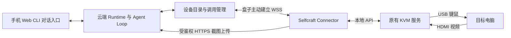

# Connector 接入与 Computer Connector 首版方案

状态：设计方案，待实施与实机验收

更新日期：2026-10-13

Selfcraft 在云端运行唯一的 Runtime，通过外接 Connector 获取设备能力。第一版在 NanoKVM-Pro 等可运行后台程序的 KVM 盒子中安装 Connector，由盒子主动连接云端，提供屏幕观察和键鼠操作。目标电脑无需安装配套程序，也不依赖 Tailscale。

统一接入机制负责设备身份、连接、能力、授权和调用；第一版只实现 Computer Connector。Camera、Phone 等未来沿用接入规则，按实际需求增加能力，不提前建设插件市场或通用远程执行平台。

产品与恢复约束沿用 [产品定位](../PRODUCT.md)、[运行与升级约定](first-version-contract.md)；手机仍是 [iPhone App 方案](ios-app-plan.md) 中的并列对话入口。

## 目标与首版边界

首版体验：用户在手机上提出任务，打开已配置的手机热点，把接入器直接连接到一台电脑并供电。Selfcraft 感知接入，在任务授权内判断目标、观察并操作电脑，最后在原对话中报告结果。目标明确时自动推进；多个候选目标、接入类型不符、超出原意或无法判断时才询问。

首版用一个简单任务验收，以 Windows 浏览器和记事本为样例，不以自动修复任意软件故障为目标：

> 在接入的电脑上打开浏览器，搜索我指定的主题，选取 3 条相关结果，把标题、链接和简短摘要写入记事本，并保存为桌面上的新文本文件。

执行流程：关联当前请求与目标 → 截图观察 → 打开浏览器搜索并查看结果 → 打开记事本新文档 → 输入整理后的内容 → 用不冲突的文件名保存 → 重新打开文件核对 → 向用户报告路径和结果，结束观察。搜索与文档操作都在目标电脑上通过键鼠完成，不能以云端搜索或在 Runtime 工作区写文件代替验收。

成功标准是目标电脑上确实保存了可重新打开的文件，包含 3 条实际看到的相关结果及对应链接，摘要有页面内容依据；不是仅收到若干键鼠调用成功。目标电脑已解锁、浏览器可联网、记事本可用，既有文件不被覆盖。中文通过目标输入法等实测可用方式输入，不假设 USB HID 能直接输入任意 Unicode 或共享剪贴板。

“插上就能用”指完成首次安装、配网与实例绑定后的日常使用，不承诺任意电脑单线连接、自动解锁或零系统设置。HDMI 视频输出、USB 键鼠识别、显示镜像、供电和网络可达仍是前提。

首版包含：

- 一个单用户 Runtime，可登记多个 Connector；实机先验收一台盒子在 A、B 两台电脑之间切换
- 统一设备目录、独立设备凭证、WSS 主动连接、状态与能力报告
- Computer 的单路截图、移动点击、滚动、短文本输入和组合键
- 每台接入器同一时间只运行一个目标控制会话和一个动作
- 手机/Web 查看设备、在有歧义时选择目标、停止控制和撤销设备
- 操作记录、重复请求去重、未知结果暂停和重连恢复

首版不包含：陪伴模式、持续视频与音频、相机和手机能力实现、外部 KVM 切换器或矩阵换机、多屏协同、文件传输、远程 Shell 通道、ATX 开关机、自研采集驱动、自动升级 Connector、任意电脑永久身份识别。通过键鼠打开目标电脑终端仍属于桌面操作，不等于获得结构化 Shell 接口。

### 任务与观察授权

授权按用户请求的语义和上下文确定，复用 Work 的目标、授权范围和请求来源，不逐次批准点击。“检查”不自动授权任意修改，“修复”可以包含请求范围内的修改；只有超出原本意图或无法判断时才询问。示例中的搜索、整理和保存新文件属于同一任务，无需逐步确认。

没有相关任务时，只上报设备、连接与能力状态，不读取或上传屏幕。有相关任务后，可以在授权范围内获取必要预览，用于判断目标是否符合描述。多个候选目标或接入类型不符时先询问，不遍历所有设备截图。任务完成、取消或暂停等待用户时停止自动观察；恢复任务时重新核实状态。陪伴模式后续另行设计。

## 架构与职责

| 部分 | 职责 |
| --- | --- |
| Runtime | 设备目录、配对与授权、目标会话、工具派发、视觉判断、任务与结果记录 |
| Connector | 主动连接、报告本地状态、校验请求、调用 KVM、保存动作记录、断线停用 |
| 原有 KVM 服务 | 视频采集、截图、USB 键鼠模拟 |
| 手机/Web | 发起任务、回答必要的澄清、显示状态、停止和撤销 |

Connector 不运行另一套 Agent Loop，不保存人格与长期记忆，不接收模型供应商密钥。设备上线不等于新增用户指令，设备能力声明也不能扩大用户授权。

设备业务位于可演化 Runtime 中，不进入 `src/supervisor/`、`src/index.ts` 或 `src/doctor.ts`。Connector 是独立部署的进程，其安装更新不等于 Runtime 演化；第一版不允许模型通过控制协议更新盒子程序或执行盒子 Shell。

## 身份与目标会话

### 四类标识

| 标识 | 含义 | 生命周期 |
| --- | --- | --- |
| `instanceId` | 绑定的 Selfcraft 实例 | 地址迁移不改变实例身份 |
| `deviceId` | 接入器的稳定身份 | 换电脑、换网络和进程重启均不改变 |
| `connectionId` | 云端分配的当前已认证连接代次 | 每次 WSS 重建都改变 |
| `targetSessionId` | 本次已关联目标的控制会话 | 换目标、结束控制或无法确认连接连续性时失效；单纯网络重连不必更换 |

`targetSessionId` 不等于电脑永久 ID，也不是模型对话中的 Session。设备显示名和用户填写的电脑名称只是标签，不能作为身份验证依据。

“关联目标”由 Selfcraft 根据当前请求、候选设备和必要的画面判断完成，不固定要求用户点击确认。语义匹配决定任务意图，系统校验负责确保动作仍属于选定的物理接入；两者不能相互替代。

一次绑定只归属于一个实例；迁移到另一实例需要解除绑定并重新配对。新连接生效时旧连接失效，双方拒绝旧 `connectionId` 的请求和响应。设备凭证由认证层映射到身份，不信任报文自行填写的 `deviceId`。

### 从 A 电脑切换到 B 电脑

| 时刻 | 接入器 | 目标会话 | 任务行为 |
| --- | --- | --- | --- |
| 接入 A 并关联任务 | `device-01` | `target-A1` | A 任务绑定此会话 |
| 拔下或选择切换目标 | `device-01` | `target-A1` 失效 | 停止后续动作，保留任务与证据 |
| 接入 B 并关联任务 | `device-01` | 新建 `target-B1` | B 任务绑定新会话，A 的旧动作始终拒绝 |
| 再接回 A | `device-01` | 新建 `target-A2` | Selfcraft 核实目标与任务进度，无法判断才询问；不重放旧动作 |

每条电脑操作同时绑定设备、连接代次和目标会话。即使延迟请求到达同一盒子，目标会话不同也必须拒绝。任务不能只保存一个 `deviceId`，然后将所有后续操作投向该盒子当前连接的电脑。

### 目标识别的实际限制

纯 KVM 无法普遍获得可信的电脑永久身份。HDMI/USB 变化只用于发现连接中断，不能证明接回的是同一台电脑；用户通过切换器换机或程序离线期间换机也可能无法完整检测。

首版只支持接入器直接连接一台电脑，通过拔插换机；实机验证 HDMI/USB 连接变化的可观测程度。网络断线与目标变化分别处理：

| 事件 | 控制行为 | 恢复方式 |
| --- | --- | --- |
| 仅 WSS 中断 | 停止后续输入，目标会话暂停 | 重新认证，核对本地连接连续性与动作结果，获取新画面后继续；不固定要求用户确认 |
| 检测到 HDMI/USB 断开或用户声明换机 | 关闭旧目标会话，拒绝旧动作 | 对当前接入重新关联任务并建立新会话，存在歧义才询问 |
| Connector 重启或本地连续性无法核实 | 旧目标会话失效，禁止自动沿用旧绑定 | 重新观察并判断目标；仍无法判断时询问 |

Connector 报告本次进程启动标识和本地接入代次；在实际可检测的 HDMI/USB 变化时递增接入代次。网络重连保留目标的前提是进程持续运行、相关物理连接持续被监测且接入代次未变。若硬件不能提供可靠的检测证据，报告未知，不能仅凭计数未变推断没有换机。每次重连仍换发 `connectionId`，旧连接消息不再有效。

新鲜预览用于任务匹配与进度核实，不用屏幕相似度、分辨率、显示器 EDID 或设备标签冒充可信电脑身份。可见画面符合描述不等于证明物理身份；对于无法检测的换机，不承诺自动防止误操作。用户可以在对话中声明换机或停止，无需管理内部会话 ID。

## 设备目录与能力管理

设备类型用于展示，能力决定可调用的工具。一台设备未来可以同时拥有屏幕、键鼠和相机能力，不按 Computer、Camera、Phone 建立互斥继承体系。

首版能力固定为 `computer.observe`、`computer.input`。能力使用有版本的静态协议定义；未知能力可显示为“不支持”，不能据设备上传的描述或代码动态生成可执行工具。

有效能力是以下条件的交集：Connector 实际支持、Runtime 理解该版本、用户已授权、设备当前可用、任务范围允许。

| 状态层 | 需要表达的事实 |
| --- | --- |
| 注册与授权 | 设备名、类型、所属实例、凭证状态、批准的能力 |
| 传输 | 在线、离线、最后有效心跳、协议版本、当前连接代次 |
| 本地条件 | KVM 服务是否可用、视频是否有效、USB 是否就绪、分辨率、忙碌原因 |
| 目标控制 | 未关联、就绪、执行中、暂停、已关闭；当前目标标签和任务绑定 |

“接入器在线”“检测到画面”“允许当前任务输入”分别展示。无法检测某项本地条件时报告未知，不默认可用。

设备登记、授权、目标历史和动作结果持久保存在 Runtime 状态库中；活跃 socket 与心跳状态保存在内存。Runtime 重启时所有设备先视为离线，所有目标控制会话关闭；重新认证后按任务授权重新核实目标与进度，能够判断就继续，存在歧义才询问。

Agent 通过 `device_list` 和 `device_status` 获取当前状态。每轮可注入简短设备概览，但工具执行前仍要查询确定性状态，不能把聊天记忆或旧概览当作可执行依据。

设备上下线与能力变化通过既有事件和通知同步入口；只有任务相关、需要用户处理的变化才产生通知或唤醒事项。心跳不进入模型上下文，也不每次触发模型调用。

## 配对与通信协议

### 一次性绑定

1. 用户在已鉴权的入口发起添加设备，Runtime 创建短期、一次性的配对票据
2. 用户通过盒子的受控本地配置入口写入云端地址和票据；票据不进入日志或 URL 查询参数
3. Connector 经 HTTPS 提交票据与协议版本，云端校验后绑定 `instanceId` 与 `deviceId`，签发设备专用随机凭证
4. Connector 将凭证保存到本机受限的 `config/secrets.json`；普通配置只保存地址与非敏感标识
5. 云端持久保存凭证摘要与授权范围，可单独撤销设备；配对响应丢失时通过重新配对恢复，不重复发放无限有效凭证

配对接口需要有效票据与尝试限制；设备通道始终要求认证。不得沿用现有 `ClientAccess` 的“未配置客户端凭证时允许本地访问”兼容逻辑，也不得把用户的完整客户端凭证交给盒子。设备凭证不能访问对话、配置、普通附件或其他设备的数据。

撤销设备会关闭现有连接并作废目标会话。Connector 在断网时无法立即收到撤销，依靠本地心跳超时停止控制；已经发出的外部操作无法撤回。

### 出站连接

- Connector 主动连接 `wss://<runtime>/api/connectors/connect`，验证 TLS 证书，在握手中携带设备凭证；需要云端域名与可达的 HTTPS/WSS 服务
- Runtime 在升级 WebSocket 前执行独立设备认证，签发 `connectionId`；反向代理必须支持 Upgrade 与长连接
- WSS 只承载有界状态、操作、停止及结果消息；截图通过单独 HTTPS 入口上传，避免图片阻塞停止消息
- 连接使用心跳及带随机抖动的重连退避；失败连接不会累计离线操作队列
- 协议初始版本为 `1`，不兼容版本明确拒绝连接并在入口显示原因
- 第一版建议心跳间隔 10 秒，30 秒无有效往返则停用本地控制；这些是待热点实测调整的实现常量，不新增用户配置项

此方案不要求盒子开放公网端口或运行 Tailscale，但仍依赖手机热点和移动网络允许出站访问。Wi-Fi 配网复用设备已有能力；不以云端连接程序替代首次配网。

### 消息与调用约束

| 消息 | 方向 | 主要内容 |
| --- | --- | --- |
| `hello` / `welcome` | 双向握手 | 协议版本、能力版本、当前连接代次 |
| `status` | 盒子到云端 | 视频、USB、本地服务、进程启动标识、本地接入代次、目标会话及错误状态 |
| `target_open` / `target_close` | 云端到盒子并确认 | 建立或关闭目标会话，绑定当前物理连接状态 |
| `observe` | 云端到盒子 | 请求预览或当前目标截图 |
| `act` | 云端到盒子 | 唯一动作标识、目标会话、画面依据、操作参数、有效期 |
| `result` / `command_status` | 双向 | 动作状态查询与已记录结果，不触发重执行 |
| `stop` | 云端到盒子并确认 | 关闭控制会话、丢弃未开始动作、释放键鼠 |

预览请求绑定当前连接、本地接入代次及有请求来源的目标关联流程，不能授权输入。`target_open` 必须在预览后核对接入未变化；网络重连恢复也必须完成当前连接上的校验，不能直接使用旧连接的预览或排队动作。普通截图和所有输入都必须属于活动目标会话。

每个请求带唯一 `commandId`。盒子对同一 ID 的不同参数直接拒绝；身份、连接、目标、能力、授权和有效期均通过校验后才可执行。有效期检查须考虑握手时估算的时钟偏差，误差超界时拒绝输入并重新同步，不能因为时钟不准放行旧动作。

每台盒子最多一个有副作用动作在执行，不接收第二个排队输入；大段文本拆成有界步骤，每步可取消。组合键默认按下并释放，首版不提供跨请求持续按住按键。`stop` 优先处理，不等待完整任务结束；断网时手机显示停止尚未确认，本地超时作为兜底。

## 观察与执行结果

### 截图

截图返回 `frameId`、`targetSessionId`、采集时间、像素宽高和附件引用。首次预览未建立目标会话时绑定目标关联流程标识。设备采集时间与云端接收时间分别记录，不用上传时间伪装采集时间。

HTTPS 上传需要有效设备凭证及云端签发的具体截图请求，只能提交该设备当前请求的结果。限制格式、实际像素尺寸、编码字节数与并发；不接受设备指定文件路径或任意外部 URL。经现有附件存储与 PathGuard 保存，设备不能凭引用读取其他附件。

第一版使用按需 JPEG/PNG 截图，建议从 1080p 开始。图像坐标从左上角计算；若缩放传给模型，必须保留到原始画面的明确映射。坐标动作需引用同会话近期画面，分辨率变化时拒绝并重新截图；画面编号不能保证界面未变化，动作后仍需检查。

视觉模型必须实际接收到像素；现有 `image_analyze` 可以复用图片读取能力，但文字摘要本身不构成可靠坐标依据。当前没有可用视觉模型时，报告不可自动操作，不猜测位置。屏幕上的文字属于外部内容，不得作为扩大工具权限或修改任务的指令。

### 执行与恢复

Connector 保存最小动作日志，执行前先持久记录，执行后再持久记录结果。建议状态为 `accepted`、`executing`、`completed`、`failed`、`unknown`；校验失败使用 `rejected`，不产生输入。

- `accepted` 只表示请求已持久接收
- `completed` 只表示本地 KVM 接口完成请求，不证明目标软件操作成功
- 在动作可能已发出、但结果未保存时，恢复为 `unknown`，不得重新执行
- 重复收到已知请求时返回原状态或结果；启动恢复时不自动执行未完成的输入
- 观察可以重新获取新截图，但必须区分新结果与原请求的历史证据
- 动作去重记录至少保留至会话关闭且全部结果完成核对；关闭会话的任何迟到输入始终拒绝

Runtime 的工具调用 ID 与 `commandId` 稳定关联，复用 Execution 的检查点与未知结果阻塞规则。即使盒子报告完成，Agent 也要通过新画面或其他实际证据判断任务完成。无法承诺键鼠输入 exactly-once，本地持久记录与物理动作之间存在无法原子提交的间隙。

任务等待设备时复用 Work，不建立第二套任务队列。现有 Work 只有 `user/time/job` 等待条件，实施时补充最小的 `device` 条件和相关设备事件唤醒；唤醒只允许重新判断目标，不直接恢复输入。只有确实需要用户回答时才使用 `waiting/user`；未知副作用按现有 Execution 规则阻塞自动重放，允许在授权范围内重新观察并核实结果，核实不了再询问。任务完成或取消后关闭控制会话，停止观察；无相关任务的设备上线只更新状态。

## 入口与最小实现布局

手机/Web 在设置中提供最小设备列表，显示设备名、在线状态、目标、可用能力和不可用原因；支持添加和撤销。任务发起、必要的目标选择和授权澄清在原对话中完成，不要求进入设置绑定每次任务。任务内提供状态与直接停止入口，停止不需要等待模型回复。设备目录允许多台设备，同时存在多个候选目标时询问用户，不按最近上线设备猜测；列表不自动显示屏幕缩略图。

普通对话不展示协议标识。提示使用“电脑已接入，开始执行刚才的搜索任务”“发现多个接入目标，请选择”“连接中断，已暂停发送操作”等用户可理解的语言。网络中断或停止未获回执时，不宣称盒子已经停止；任务结束报告实际保存路径和核实结果。浅深主题、错误、加载、空状态、键盘焦点与移动端布局按仓库入口规范验收。

以下为拟实施位置，不代表现有功能已经支持：

| 位置 | 最小改动 |
| --- | --- |
| `src/connector/` | 设备注册、独立认证、目标会话、连接代次、请求派发；优先简单模块与数据结构 |
| `src/web/web-server.ts` | WSS Upgrade、设备专用截图入口、用户设备管理与停止接口 |
| `src/tools/computer-tools.ts` | `device_list`、`device_status`、`computer_observe`、`computer_act`，定义明确参数 |
| `src/tools/index.ts` | 注入设备服务，复用工具时间线与执行记录 |
| `src/runtime-entry.ts` | 组装设备服务，关停时关闭会话与连接 |
| `src/execution/`、`src/work/` | 复用既有状态机，补充设备等待、相关事件唤醒与目标绑定，不改写历史语义 |
| `connectors/computer/` | 盒子端程序、本地 KVM 适配、动作日志、系统服务与安装说明 |
| `web/`、`ios/` | 最小设备管理、对话内目标澄清和直接停止入口，共用 Runtime 状态 |

云端维持 Bun + TypeScript。盒子端优先做单一可执行程序和系统服务，语言与构建目标在实机确认 CPU、系统、依赖和服务管理方式后确定；不为不同语言复制业务规则。首版只实现 PiKVM 本地适配，不预建供应商抽象层。

NanoKVM-Pro 作为首个验收设备：保留原厂系统和采集服务，Connector 调用本地 PiKVM API。首次手动安装、自启动、异常重启；厂商更新后的程序保留与恢复需要实测。更新包只由用户管理，自动更新、签名发布体系后续另行设计。

持久数据沿用文件系统边界：设备与授权摘要、会话历史进入实例状态 SQLite；截图进入受保护附件目录；Connector 动作日志只保存在盒子自己的受限目录。新增表/字段保持回滚兼容，凭证明文不进入日志、普通配置、仓库或测试夹具。

## 实施顺序与验收

| 阶段 | 交付 | 通过条件 |
| --- | --- | --- |
| 1 实机可行性 | 盒子安装、热点联网、PiKVM 截图和键鼠、视觉输入与中文输入验证 | 在受控目标上跑通搜索、记事本输入和保存；确认硬件与模型能支撑基本操作 |
| 2 最小接入 | 独立鉴权、WSS、设备状态、目标绑定、动作记录和停止 | 在已配对实机上端到端调用，拒绝旧连接和旧目标动作，未知结果不重放 |
| 3 完整体验 | 手机原对话发起任务、任务语义授权、设备等待与必要询问、最小配对与管理入口 | 无逐步确认地完成示例任务，重新打开文件核实内容，任务结束停止观察 |
| 4 异常验收 | 热点断线、进程重启、A/B 拔插、多目标和撤销 | 网络恢复与换机分开处理，无任务不读取屏幕，歧义会询问，停止不依赖模型 |

核心自动化测试：

- 配对票据过期、重复消费、错误设备凭证、撤销现有连接、跨设备截图上传与越权 API
- 旧连接迟到消息、重复连接、旧目标命令、目标切换时正在执行的动作和晚到截图
- 同 ID 同参数去重、同 ID 不同参数拒绝、执行前/执行后掉电、结果丢失与查询恢复
- 会话失效、心跳超时、停止并发、分辨率变化、过期动作、时钟偏差和不支持的能力
- 截图读取重试与有副作用输入不重试，Work/Execution 恢复不自动跨目标继续
- 无任务上线不请求截图；任务结束停止观察；多个候选目标先询问；设备事件只唤醒相关未结束任务
- 同一次本地接入在网络重连后重新核实并恢复；接入代次变化、重启或监测能力不足时不自动沿用旧绑定

实机验收至少包括：

1. 开启已保存热点，盒子冷启动后自动连接；手机锁屏、热点关闭与恢复均记录实际表现
2. 不在目标电脑安装程序，完成截图、点击、滚动、英文与中文输入检查，记录输入法和键盘布局限制
3. 用户从手机发起搜索并记录到记事本的示例任务，核实目标电脑完成浏览器搜索、新建文档、保存与重新打开，记录实际文件路径和内容依据
4. A 上任务未完成时切到 B，故意发送旧指令，确认拒绝；接回 A 时新建会话并核实进度
5. 分别测试操作期间断网、重启 Connector 与 Runtime；只有能核实本地接入连续性的网络恢复才保留目标会话，其他情况重新关联，未知动作不重放且键鼠释放
6. 手机停止、设备撤销和本地断开均阻止后续控制；已启动的电脑进程不会被虚假描述为已撤销

实机前必须核实：具体 SKU 的 Wi-Fi、本地 PiKVM API/认证行为、HDMI/USB 状态可观测程度、系统服务与持久目录、固件更新影响。模拟设备通过不等于这些条件已经验证。

实现时执行仓库要求的 `bun run typecheck`、`bun test`、`bun run doctor`、`bun run smoke:evolution`、`bun run smoke:provider`。涉及 Agent 工具调用时使用显式 `SELFCRAFT_TEST_*` 环境变量运行真实模型验收；另增加设备协议与真实 KVM 的针对性验收，现有 smoke 不能替代硬件验收。

## 后续能力与参考

Camera Connector 复用设备身份与通信，增加拍照等明确能力；Phone Connector 按移动系统实际权限和前后台限制设计，不能承诺任意后台长期 WSS。对话入口身份与设备能力身份分别授权。实时音视频、文件传输和其他供应商适配，在有实际调用场景后分别设计。

统一的是身份、授权、能力描述、会话和调用结果，不要求未来所有数据都使用 WSS，也不要求所有硬件运行同一种语言。

官方资料用于确认现有硬件/接口条件，本文其余协议和生命周期规则是 Selfcraft 的拟实施设计：

- [NanoKVM-Pro 系统与 PiKVM 模式](https://wiki.sipeed.com/hardware/en/kvm/NanoKVM_Pro/extended.html)
- [NanoKVM-Desk 配网与系统说明](https://wiki.sipeed.com/hardware/zh/kvm/NanoKVM_Pro/desk_start.html)
- [PiKVM 截图与键鼠 API](https://docs.pikvm.org/api/)
